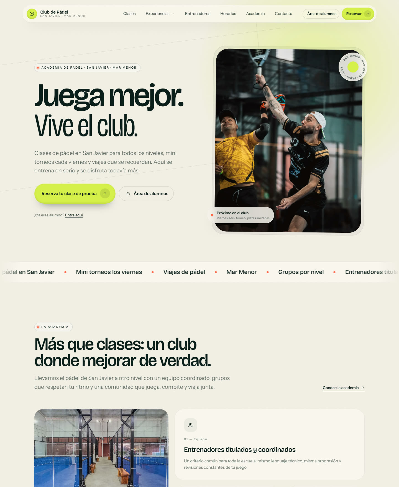
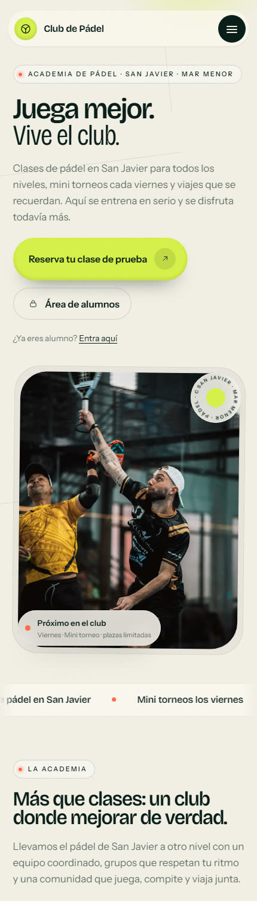
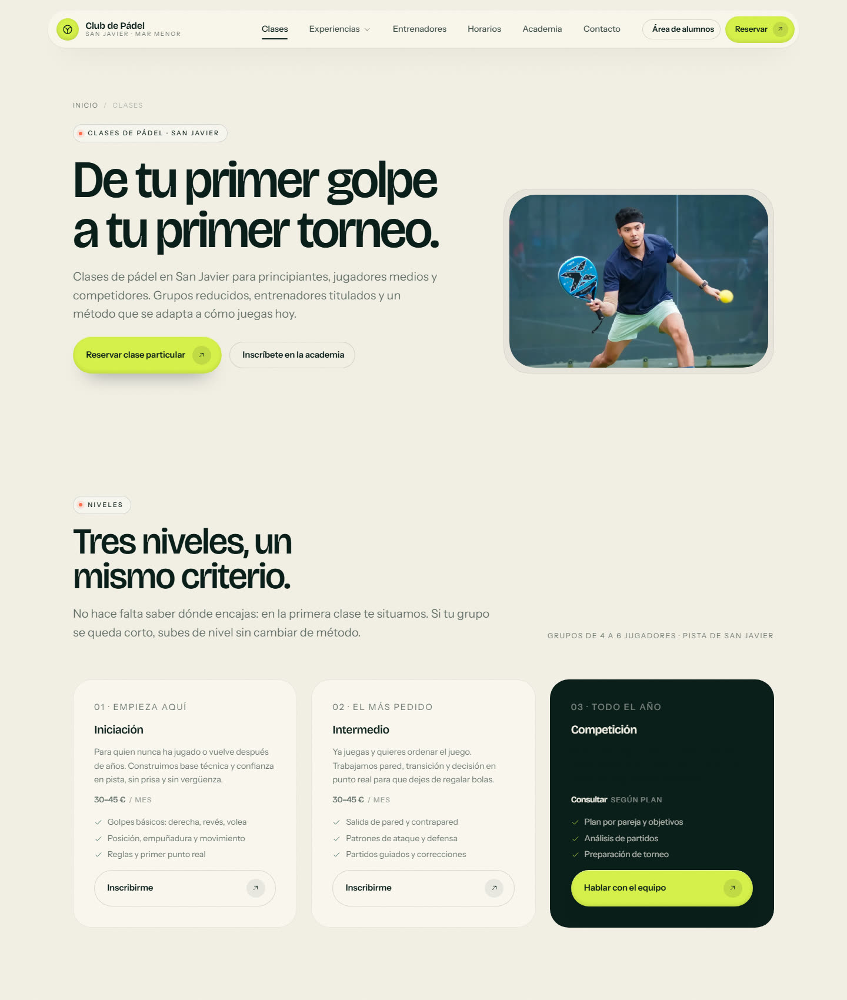
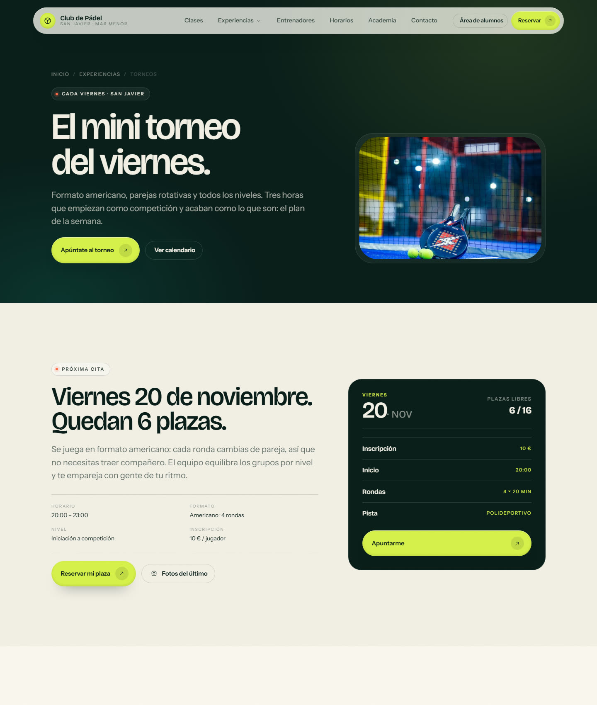

# Club de Pádel San Javier — web

Sitio estático de la academia de pádel de San Javier (Mar Menor): clases, academia,
mini torneos de los viernes, viajes, horarios y contacto.

Rama de trabajo: `deepseek`.



---

## Capturas

| Home · escritorio | Home · móvil |
| --- | --- |
|  |  |
| **Clases** | **Mini torneos** |
|  |  |

---

## Páginas

| Archivo | Contenido |
| --- | --- |
| `index.html` | Home: hero, beneficios, niveles, torneo del viernes, viajes, equipo, precios, reseñas, ubicación y CTA final |
| `clases.html` | Niveles, formatos, precios, método y FAQ |
| `torneos.html` | Próximo torneo, calendario, formato, ranking y galería |
| `viajes.html` | Filosofía de viaje, tres destinos, condiciones y galería |
| `academia.html` | Quiénes somos, metodología, instalaciones, escuela de menores y padel camp |
| `entrenadores.html` | Equipo, especialidades y coordinación |
| `horarios.html` | Horario semanal, cuotas, particulares y bonos |
| `contacto.html` | Formulario (abre WhatsApp), datos, mapas y FAQ |
| `area-alumnos.html` | Acceso privado (maqueta de login, sin backend) |
| `legal.html` | Aviso legal, privacidad y cookies (texto base) |

`404` no está personalizado: Netlify sirve el suyo por defecto.

---

## Estructura

```
index.html … area-alumnos.html     ← HTML generado (no editar a mano)
sitemap.xml, robots.txt            ← generados
assets/
  css/site.css                     ← tokens, reset, tipografía, layout, nav, footer
  css/components.css               ← botones, tarjetas, tablas, formularios, bento…
  css/pages.css                    ← componentes de páginas internas
  js/site.js                       ← menú, dropdown, reveals, raíl, formulario, vídeo
  img/*.webp                       ← fotografía optimizada
  video/club-loop.mp4 + poster     ← bucle de pista (autohospedado)
src/pages/*.html                   ← cuerpos de página (fuente editable)
tools/build.py                     ← generador de HTML + sitemap/robots
tools/media.py                     ← optimización de imágenes y vídeo
tools/shoot.mjs, tools/inspect.mjs ← capturas e inspección con Chrome headless (QA)
netlify/functions/reviews.js       ← función heredada de reseñas de Google
img/                               ← fotos originales del club (fuente)
```

---

## Trabajar en el sitio

1. Edita **solo** `src/pages/*.html`, `assets/css/*` o `assets/js/site.js`.
2. Regenera el HTML:

   ```bash
   python tools/build.py            # todas las páginas + sitemap + robots
   python tools/build.py clases.html  # solo una
   ```

3. Previsualiza:

   ```bash
   python -m http.server 8137
   # http://127.0.0.1:8137/
   ```

Los cuerpos de página usan tokens que el generador sustituye:

| Token | Resultado |
| --- | --- |
| `%%WA_CLASE%%`, `%%WA_PARTICULAR%%`, `%%WA_TORNEO%%`, `%%WA_VIAJE%%`, `%%WA_INSCRIPCION%%`, `%%WA_CAMP%%`, `%%WA_MENORES%%`, `%%WA_ALUMNO%%`, `%%WA_INFO%%`, `%%WA%%` | enlaces de WhatsApp con mensaje precargado |
| `%%TEL%%`, `%%TEL_HREF%%` | teléfono visible y `tel:` |
| `%%ADDRESS%%`, `%%MAPS%%`, `%%IG%%`, `%%YEAR%%` | dirección, Google Maps, Instagram, año |

La cabecera, el menú móvil, el footer, los botones flotantes y el sprite de iconos se
definen una sola vez en `tools/build.py` (`nav()`, `menu()`, `footer()`, `floating()`).

---

## Publicación

Netlify publica la raíz del repositorio tal cual: `netlify.toml` mantiene la carpeta
`netlify/functions` y la redirección `/api/reviews`. No hay build de Netlify: el HTML
generado se versiona.

Actualiza `SITE_URL` en `tools/build.py` cuando haya dominio definitivo (afecta a
`canonical`, `og:url`, `sitemap.xml` y `robots.txt`).

---

## Medios

- Fotografía de acción y destinos: **Pexels** (licencia libre, uso comercial, sin
  atribución obligatoria). Son imágenes provisionales hasta tener material propio.
- Retratos de entrenadores: **fotos reales del club** (`img/`), recortadas en 4:5 y
  convertidas a WebP; se muestran en blanco y negro y recuperan color al pasar el ratón.
- El vídeo del hero de comunidad es un clip de archivo de Pexels, regradado y
  recomprimido a 1280×720 (≈2 MB) y servido desde `assets/video/`.

Para regenerar los medios (requiere las fuentes en `.tmp/shortlist`, que no se
versionan):

```bash
python tools/media.py
```

---

## Accesibilidad y rendimiento

- HTML semántico, un solo `h1` por página, `skip link`, foco visible y menú con
  `aria-expanded` + trampa de foco.
- Contraste alto en texto y botones; el lima solo se usa con texto tinta.
- `prefers-reduced-motion` desactiva reveals, parallax y bucle de marquesina.
- Imágenes en WebP con `width`/`height`, `loading="lazy"` salvo la principal.
- Animaciones solo con `transform`/`opacity`; `backdrop-filter` únicamente en nav y menú.
- Sin dependencias JS. Solo se carga Google Fonts (dos familias).

---

## Estado

- Maqueta funcional lista para revisión de negocio y contenido.
- El login del área de alumnos es visual: falta conectar el sistema de reservas.
- Los datos marcados como provisionales están listados en
  [`docs/CONTENIDO-PENDIENTE.md`](docs/CONTENIDO-PENDIENTE.md).
- La versión anterior del sitio sigue disponible en el historial:
  `git show main:index.html`.
